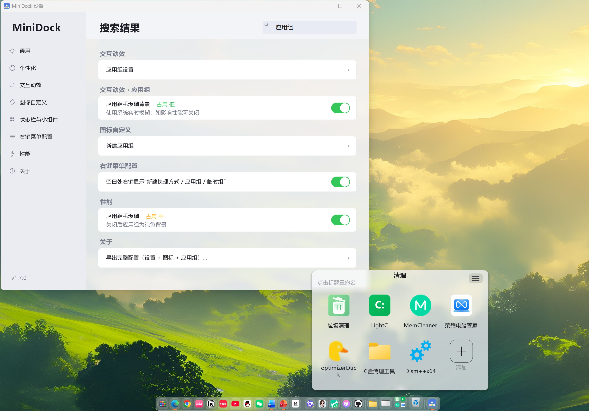

<div align="center">


# MiniDock

**一个极致轻量、追求低资源占用的 Windows 11 风格 Dock 栏**

纯 Win32 + GDI+ 实现 · 单文件 C 源码 · 免安装 · 便携

   

[下载](https://github.com/wang01116/MiniDock/releases/latest) · [功能特性](#-功能特性) · [快速上手](#-快速上手) · [配置说明](#-配置说明)


</div>


## ✨ 简介

MiniDock 是一个参考 macOS Dock 风格的 Windows 桌面 Dock 栏。它使用 **纯 Win32 API + GDI+** 编写，不依赖任何运行时框架，追求**极致低内存占用**与流畅体验。

你可以固定应用、文件夹、网址，使用应用组、磨砂玻璃、悬停放大、窗口预览、最小化飞入动画等能力，并且每一项功能都可以单独开关，按需关闭以进一步降低资源占用。

> 整个程序由单个 `minidock.c` 文件构成，配置保存在 `MiniDock.ini` 中，exe 旁边放一个 `MiniDock.portable` 文件即可切换为便携模式。


## 🚀 功能特性

### 基础能力

- 📌 固定应用、文件夹、网页应用（Edge / Chrome `--app` 模式）
- 🗂 应用组：拖拽合并、组内排序、长名称自适应、磨砂玻璃背景
- 🗑 回收站：拖入即删除（可撤销）、清空回收站
- ⌨ 全局快捷键 `Ctrl + Alt + D` 显示 / 隐藏 Dock
- 🕐 时间 / 日期卡片、📝 速记工具

- - - 

- 启动台（可设置小启动台、搜索引擎配置、标签页）
- 顶部状态栏（控制中心、小组件、实时通知、日历）
- dodk栏小组件（农历干支历、专注模式、关机/重启、资源监视器；速记）
- 多显示器支持、任务栏透明/隐藏、文件夹/Office多窗口分开显示
- 图标深色模式切换、单选项卡配置导出、游戏模式识别
- 性能检测与高耗能关闭

### 视觉与动画

- 🌫 经典毛玻璃（模糊背景）+ Material You 风格渐变 + winui云母材质
- 🎨 图标底盘（实心 / 半透明分离，支持跟随系统深浅色）
- 🎢 悬停放大、图标倒影、运行指示条（可自定义颜色）、分割线边距及颜色
- 🎬 启动弹跳、最小化飞入 Dock 动画（神奇效果、图标非线性飞入）、窗口预览（DWM 缩略图 / 列表显示
- 📁 文件夹弧形堆叠展开（可调弧度、拖出复制 / 剪切）、悬停动效

### 极致低占用

- 空闲时无常驻动画定时器，图像仅在交互时刷新
- 所有高耗能功能（磨砂玻璃、窗口扫描、预览等）均可单独关闭
- 设置中明确标注每个开关的**性能影响等级**
- 内存回收

## 📥 下载与安装

### 直接使用

1. 前往 [Releases](../../releases) 下载最新版 `MiniDock.exe`。
2. 双击运行即可，**无需安装**。
3. 首次运行会在任务栏托盘显示图标，右键可打开 Dock 设置。
4. 之后可在「Dock 设置 → 关于 → 检查更新」里直接升级：程序自行测速选择镜像、下载并校验 SHA-256，确认无误后重启替换，无需手动覆盖 exe。

> 配置默认保存在 `%APPDATA%\MiniDock\`；若希望随身携带，在 exe 同目录新建一个名为 `MiniDock.portable` 的空文件，配置与图标缓存便会保存在 exe 旁边。

### 从源码构建

需要 [MinGW-w64](https://www.mingw-w64.org/)（`gcc` + `windres`）：

```bash
cd MiniDock-source
windres -O coff res/app.rc -o app_res.o -Ires
gcc -Os -mwindows -s -static-libgcc -o MiniDock.exe minidock.c app_res.o \
    -lgdiplus -lole32 -loleaut32 -lshell32 -lshlwapi -luser32 -lgdi32 \
    -lcomctl32 -lcomdlg32 -luuid -lurlmon -lversion -ldwmapi -ladvapi32 -lpsapi -lwinhttp
```

Windows 下也可以直接运行仓库中的 `build.bat`。

## 🎯 快速上手

| 操作       | 说明                            |
| -------- | ----------------------------- |
| 添加图标     | 把桌面应用 / 文件 / 网址直接拖到 Dock 上    |
| 移除图标     | 右键图标 → 从 Dock 移除，或拖出 Dock 后松开 |
| 调整顺序     | 直接拖动图标到新位置                    |
| 新建应用组    | 右键 Dock 空白处 → 新建应用组；再把图标拖到组上  |
| 组内排序     | 打开应用组后直接拖拽组内图标                |
| 最小化 / 恢复 | 点击 Dock 中已运行的应用图标             |
| 设置       | 右键 Dock → Dock 设置（或双击托盘图标）    |
| 显示 / 隐藏  | `Ctrl + Alt + D`              |

## ⚙️ 配置说明

所有配置均通过图形化设置界面修改，保存到 `MiniDock.ini`。

| 分类    | 主要可配置项                                            |
| ----- | ------------------------------------------------- |
| 通用    | 开机自启动、锁定布局、运行中应用、快捷键、设置窗口主题、配置文件夹位置               |
| 个性化  | 图标大小、间距、栏圆角、Dock 主题、背景材质、不透明度、模糊强度、边框、渐变方向与分色不透明度；底盘（实心/半透明 + 深浅色/跟随系统 + 不透明度 + 圆角）、运行指示条颜色、标签、倒影 |
| 交互动画 | 停靠边缘、显示器、距边缘距离、常驻 / 自动隐藏 / 智能隐藏、避让最大化窗口；悬停放大与放大后大小、文件夹弧形展开（弧度/间隔/拖出方式）、弹跳、最小化动画、窗口预览          |
| 小组件与状态栏   | 时间/日期（显示内容 + 颜色）、速记                               |
| 性能 | 各高耗能开关（含性能影响标注）、一键低占用模式                           |

**导入 / 导出**：支持导出 / 导入完整配置、仅设置、仅应用与图标，以及每个选项卡的独立配置（`.mdock` 格式）。

## 📝 更新日志

### 🐛 Bug 修复

- 修复设置中「深色 / 浅色」切换名称颠倒的问题
- 修复右键应用图标「设置图标…」无反应
- 修复磨砂玻璃效果错误，改为经典毛玻璃并消除背景回环残影
- 修复「显示栏边框」开关无效 / 边框不可见
- 修复深色主题下分割线不可见
- 修复「悬停放大后大小」设置位置不符合直觉（已归入行为与动画）
- 修复最小化动画失效，并新增「点击运行中图标最小化 / 再点恢复」
- 修复无法拖入回收站、拖入回收站易误触
- 修复右键菜单无法点击空白处关闭
- 修复跟随系统深浅色切换延迟
- 修复空闲内存回收导致被系统清理工具误关闭
- 修复关闭重开后图标显示大小变化
- 修复应用组：无法拖入 Dock 内图标、深浅色不跟随、长名称显示不全、移除即关闭、无法排序、打开延迟、无法点击空白关闭

### 🎉 新增功能

- 配置文件自定义位置
- 底盘、指示条、渐变、倒影、时钟等多项外观 / 组件增强
- 速记现代化（深浅色、加粗 / 斜体 / 项目符号、临时保存 / 删除 / 预览 / 导出）
- 文件夹弧形展开参数化 + 图标拖出（复制 / 剪切）+ 右键操作
- 应用组磨砂玻璃背景（可关闭并标注性能）
- 精简右键菜单，新增「新建快捷方式（网址 / 应用）」与「新建应用组」
- 设置搜索框、常用图标一键添加、性能影响小字标注
- 每个选项卡独立导入 / 导出 + 总配置导入 / 导出

## 📂 目录结构

```
MiniDock/
├── MiniDock.exe               # 编译好的可执行文件
├── README.md
└── MiniDock-source/
    ├── minidock.c             # 全部源码（单文件）
    ├── build.bat              # Windows 一键构建脚本
    └── res/
        ├── app.rc             # 资源脚本（版本信息 / 图标 / 清单）
        ├── app.ico            # 应用图标
        └── app.manifest       # DPI 感知 / 视觉样式清单
```

## 🛠 技术栈

- **语言**：C（C99）
- **GUI**：Win32 API + GDI+ Flat API（手动声明，无需 `gdiplus.h`）
- **依赖**：仅系统 DLL（`gdiplus`、`shell32`、`dwmapi` 等），静态链接 libgcc
- **体积**：约 230 KB 的单文件 exe

## 🤝 贡献

欢迎提交 Issue 与 Pull Request。建议：

1. 先开 Issue 描述问题或想法
2. 保持单文件 `minidock.c` 的简洁风格
3. 新增功能优先保证**无 bug、可关闭、不增加空闲资源占用**

## 📄 许可证

本项目源码版权归原作者（Wangcy）所有。如需转载、分发或二次开发，请先联系作者确认许可。

## 🙏 致谢

- 参考 macOS Dock 的交互与视觉设计
- 使用 [MinGW-w64](https://www.mingw-w64.org/) 构建

> Made by Wangcy
