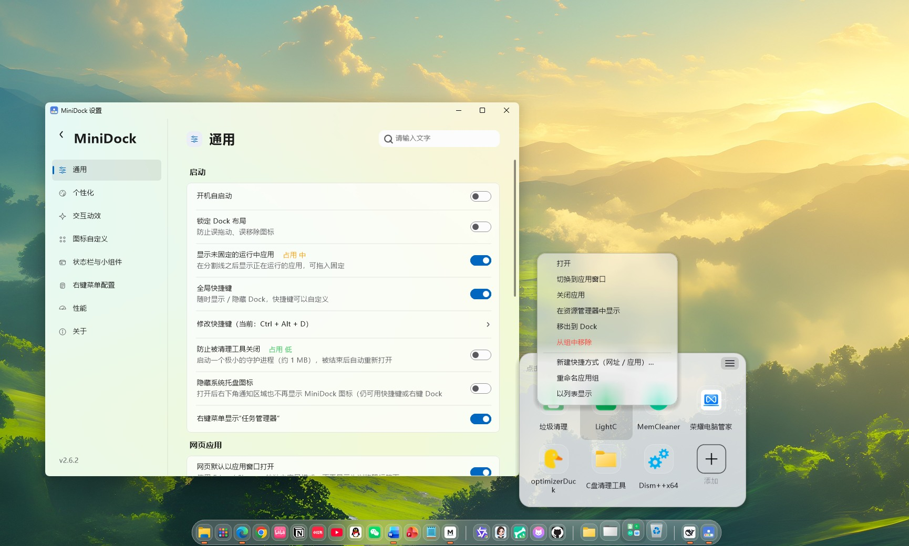
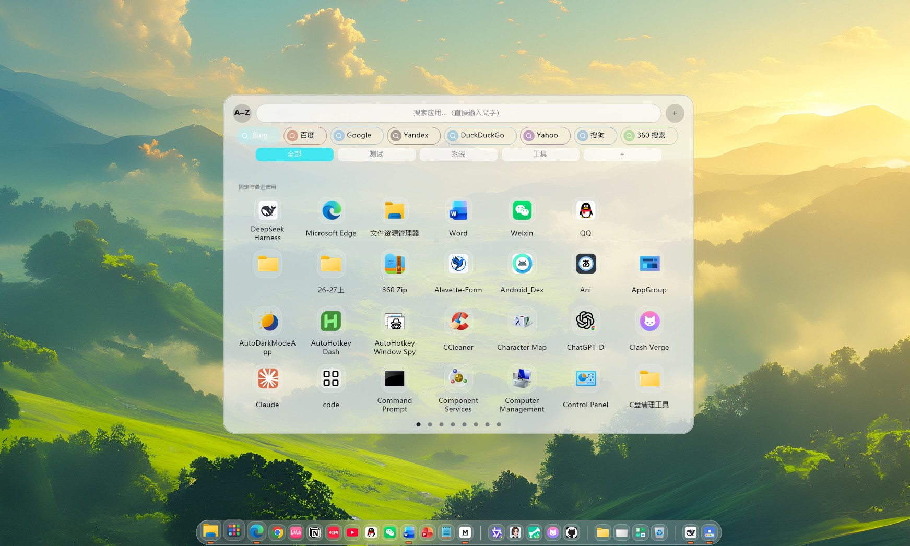
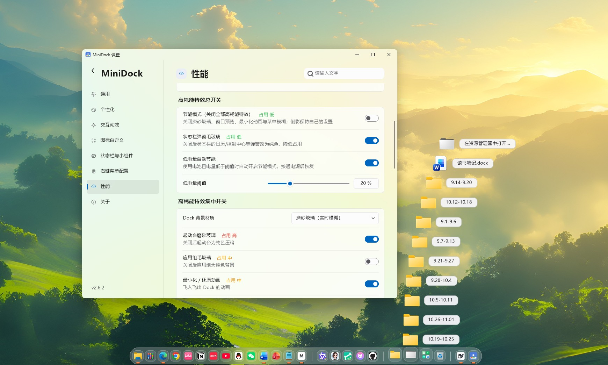
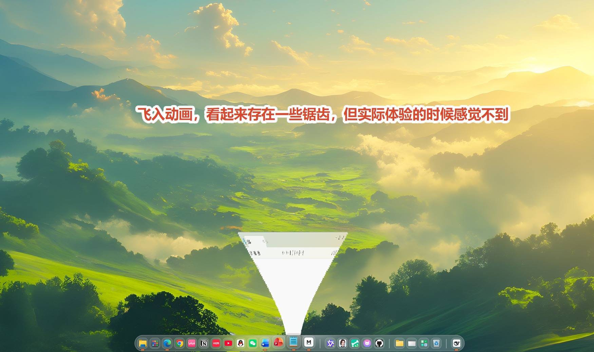

<!--
  Maintainer notes (check before publishing):
  1. Logo path above points to docs/logo-128.png — update the raw.githubusercontent.com URL if your repository uses another path;
  2. Language switch points to README.md / README.en.md — adjust if your filenames differ;
  3. Download links: GitHub Releases and the Quark mirror;
  4. Website: https://wang01116.github.io/MiniDock
-->

<div align="center">


# MiniDock

**A ~400 KB Dock and macOS-style top status bar for Windows**

Hand-written in C with Win32 + GDI+. No Electron, no .NET, no VC++ runtime — a single portable executable.

[](#-system-capabilities)
[](#-ultra-low-footprint)
[](#-tech-stack)
[](#-license)

[简体中文](README.md) · [English](README.en.md) · [Website](https://wang01116.github.io/MiniDock) · [Download](#-download--install)

<!-- Language switch: replace README.md / README.en.md above if your files use different names. -->
|  |  |  |  |
| :---: | :---: | :---: | :---: |
| Setting | Search | ~ | ~ |

</div>

---

## 📖 Table of Contents

- [Introduction](#-introduction)
- [Features](#-features)
  - [Dock](#dock)
  - [Launchpad](#-launchpad)
  - [Top Status Bar & Widgets](#-top-status-bar--widgets)
  - [System Integration](#-system-integration)
  - [Settings](#-settings)
- [System Capabilities](#-system-capabilities)
- [Visuals & Animations](#-visuals--animations)
- [Ultra-low Footprint](#-ultra-low-footprint)
- [Download & Install](#-download--install)
- [Usage](#-usage)
- [Quick Start](#-quick-start)
- [Build from Source](#-build-from-source)
- [Configuration](#-configuration)
- [Project Layout](#-project-layout)
- [Tech Stack](#-tech-stack)
- [FAQ](#-faq)
- [License](#-license)
- [Credits](#-credits)

---

## 🌟 Introduction

MiniDock brings two things from macOS to Windows and does them properly: a **Dock** for your apps and windows, and a **top status bar** for time, control center, tray, battery and system stats.

It is not an "everything suite". It is deliberately small, native and controllable:

- 🪶 **Light** — single file, no installer, no services, no registry footprint
- 🎛 **Controllable** — 20+ high-cost effects can be disabled individually; low / balanced / high presets
- 🧩 **Native** — pure Win32 + GDI+, Per-Monitor V2 DPI, no UI framework or web runtime
- 🆓 **Open source** — build it, modify it, ship it

> Website: <https://wang01116.github.io/MiniDock>

---

## 🧱 Features

### Dock

- Pin **applications, folders, URLs and Start-menu apps**; drag them in from Explorer or Start
- **Merge or separate windows**: one icon per app, or one icon per document / Explorer window
- **Window previews** with live DWM thumbnails, multi-window layout, click to focus
- **App groups**: drop icons together, rename, change icon, background color and opacity, reorder
- **Folder arc fan**: adjustable curvature (0 = vertical), drag files out, context menu, sorting
- **Quick notes**: rich text, temporary storage, export to txt / Markdown
- **Temporary scratch group** for files you are working on; cleared on restart
- **Running indicators**: bars or dots, color / style / size configurable
- **Taskbar control**: hide / auto-hide / permanently hide; hold Ctrl at the edge to peek; restoring returns your original taskbar settings
- **Multi-monitor**: fixed monitor, follow the mouse, or **show on every monitor** (per-monitor mirroring, DPI-aware placement)

### 🚀 Launchpad

- Full-screen grid or a **compact launchpad** window; both share apps, tags and background settings
- Type to search, Enter to launch, Esc to close; IME composition is positioned inside the search field
- **Built-in search engine bar**: Bing, Baidu, Google, Yandex, DuckDuckGo, Yahoo, Sogou, 360, Ecosia, Bilibili, GitHub, CNKI, YouTube
  - Enable / disable, **reorder, recolor, rename, delete**
  - **Custom engines** (name + URL template with `%s` + color)
  - Bind each engine to Edge / Chrome / Firefox / the default browser
- Tag categories with drag-to-reorder, rename and delete; search bar sits above the tag row

### 📊 Top Status Bar & Widgets

A macOS-style top bar, or Dock widgets if you prefer:

- Time & date (lunar calendar, sexagenary cycle, seconds, fonts and colors)
- Control center (Wi-Fi, Bluetooth, dark mode, location, mute, volume, battery)
- Notifications (takes over taskbar flashing / unread hints, click to jump)
- Resource monitor (CPU / memory / disk)
- Timer & to-do, focus modes, system tray, power menu
- **Battery health**: design capacity, full-charge capacity, health, cycle count via WMI; missing fields are shown as "Unavailable", never estimated
- **IME widget**: shows 中 / EN and toggles input method; independent switch and works on the Dock without the top bar
- Widgets support **double width**, merged capsules, left/right placement and ordering

### 🧷 System Integration

- **WeChat / QQ tray wake**: click the Dock icon to bring back the real, interactive chat window
- **Launch when not signed in**: if only background processes exist, the login window is started
- **Strict app-family matching**: WeChat lights up only WeChat, QQ only QQ — no false running dots
- **Maximized-window avoidance** (optional)
- Auto-start, global hotkeys, layout lock
- **Config import / export** for settings, Dock contents and launchpad data
- **Diagnostic log**: off by default, opt-in, events and error codes only — no titles, paths, input or screenshots

### ⚙ Settings

Custom-drawn, Mica backdrop, follows system light/dark, with search and per-page reset:

- General / Personalization / Position & Displays / Interactions / Status Bar & Widgets / Icons / Context Menu / Performance / About
- Each page supports **export / import this page** and **restore this page's defaults**
- Dedicated sub-pages for launchpad, search engines and battery

---

## 🪟 System Capabilities

| Capability | Details |
| --- | --- |
| Native Win32 | Pure Win32 + GDI+, no Electron / .NET / Qt / browser engine |
| Single portable exe | ~400 KB, runs from any folder |
| Per-Monitor V2 DPI | Consistent window, icon and font sizing across mixed scaling |
| AppBar integration | Reserves desktop space so maximized windows avoid the Dock |
| WinEvent hooks | Snapshot-based minimize / restore without blocking the target window |
| WMI battery data | Reads design capacity, full-charge capacity and cycle count from firmware |
| UI Automation | Wakes tray apps by invoking the taskbar button, without moving the real cursor |
| Single instance + hotkey | Re-launch summons the existing instance; hotkey is configurable |
| Config & logs | Portable ini; optional, size-capped diagnostic log |

---

## 🎨 Visuals & Animations

- **Snapshot genie**: minimize and restore fold the same snapshot into / out of the Dock icon; Electron and Explorer are covered by fallback capture; no first-frame flash, consistent aspect on restore
- **Frosted / frozen / solid / gradient** Dock and launchpad backdrops
- **Icon reflections, hover zoom, press feedback, tooltips** — each individually switchable
- **Status bar motion**: hover/press transitions, capsule expansion, control-center popover
- **Mica settings window**, following system theme
- **Frame pacing** aligned to the monitor refresh rate via `DwmFlush`; no idle animation timers

---

## 🍃 Ultra-low Footprint

- **Size**: ~400 KB regular build, ~190 KB with UPX
- **Working set**: returned right after startup and then every 10 seconds when idle — single-digit MB at rest
- **Private memory**: roughly 14–16 MB
- **No idle animation timers**: no periodic repaint when nothing happens
- **On-demand subsystems**: status bar, guardian, mirror windows and engine bar are only created when enabled
- **Eco mode**: one switch disables frosting, previews, reflections and animations; optional low-battery automation
- **Presets**: low / balanced / high resource, plus 20+ individual toggles

---

## 📥 Download & Install

- [GitHub Releases](https://github.com/wang01116/MiniDock/releases/latest)

**Install**

1. Download `MiniDock.exe` (or the compressed build);
2. Put it anywhere (a non-system drive is recommended);
3. Double-click to run — no installer, no admin rights;
4. Configuration is created next to the exe, or under `%APPDATA%\MiniDock` if redirected.

> Windows 10 / 11 x64. Some materials (Mica) require Windows 11 22H2+.

---

## 🕹 Usage

| Action | Result |
| --- | --- |
| Left-click a Dock icon | Launch / switch; click again to minimize |
| Right-click a Dock icon | Open, reveal in Explorer, copy path, add to tray residents, remove |
| Drag an icon | Reorder; drop onto another icon to create a group |
| Hover an icon | Zoom, label, window preview |
| Right-click empty Dock area | Settings, layout lock, quit |
| Global hotkey | Show / hide the Dock (editable) |
| Top status bar | Click time for calendar, control center / tray / battery for panels |
| Launchpad | Type to search; click an engine chip, press Enter to search with it |
| Compact launchpad | Click outside to close; right-click apps to pin / remove |

---

## ⚡ Quick Start

1. **Run** `MiniDock.exe` — the Dock appears at the bottom;
2. **Add apps** by dragging shortcuts, folders or URLs onto the Dock;
3. **Organize**: drag to reorder; drop icons together to make groups;
4. **Status bar**: Settings → Status Bar & Widgets, enable the top bar and pick widgets;
5. **Tune**: Settings → Performance, choose low / balanced / high, or disable individual effects.

---

## 🔧 Build from Source

**Requirements**

- Windows 10 / 11 x64
- MinGW-w64 x86_64 (`gcc` + `windres`)

**Build**

```bat
windres -O coff res/app.rc -o build_res.o -Ires
gcc -Oz -fno-ident -fno-unwind-tables -fno-asynchronous-unwind-tables ^
    -fmerge-all-constants -fno-math-errno -mno-stack-arg-probe -fno-jump-tables ^
    -mwindows -s -static-libgcc ^
    -Wl,--gc-sections,--file-alignment=512 ^
    -o MiniDock.exe minidock.c modules\battery_health\battery_health.c build_res.o ^
    -lgdiplus -lole32 -loleaut32 -lshell32 -lshlwapi -luser32 -lgdi32 ^
    -lcomctl32 -lcomdlg32 -luuid -lwbemuuid -lurlmon -lversion -ldwmapi ^
    -ladvapi32 -lpsapi -luxtheme -liphlpapi -limm32 -lwtsapi32 -lpowrprof ^
    -lmsimg32 -lwinmm -luiautomationcore
```

> The bundled `build.bat` contains equivalent flags. Avoid `-ffunction-sections -fdata-sections` together with `--file-alignment=512`: the executable becomes several times larger.

---

## ⚙ Configuration

- File: `MiniDock.ini` (next to the exe; `%APPDATA%\MiniDock\location.txt` can redirect it)
- Sections cover Dock appearance and behavior, position and monitors, animation, status bar and widgets, launchpad, search engines, battery, performance
- Settings pages support **export / import this page**; About supports **full config export** and **restore defaults**
- Diagnostic log is opt-in, size-capped (~2 MiB), exportable / clearable

**Search engine example**

```ini
[SearchEngines]
Count=2
Name0=Bing
Url0=https://www.bing.com/search?q=%s
Color0=0x66B4F0F7
On0=1
Browser0=0
Name1=My engine
Url1=https://example.com/search?q=%s
Color1=0xFF3A6EA5
On1=1
Browser1=2
```

> `%s` is the query placeholder; `Browser` 0 = default, 1 = Edge, 2 = Chrome, 3 = Firefox.

---

## 📁 Project Layout

```text
MiniDock/
├─ minidock.c                 # main program (single file)
├─ modules/
│  └─ battery_health/         # WMI battery-health module (.c / .h)
├─ res/
│  ├─ app.rc                  # resources (icon / version info / manifest)
│  ├─ app.manifest            # DPI awareness and compatibility
│  └─ app.ico                 # application icon
├─ build.bat                  # build script
├─ README.md                  # Chinese README
└─ README.en.md               # this file
```

---

## 🧰 Tech Stack

- **Language**: C (MinGW-w64 GCC)
- **UI**: Win32 + GDI+ custom drawing, double buffering and layered windows
- **System APIs**: AppBar, WinEvent hooks, DWM (Mica / thumbnails), WMI, UI Automation, Shell
- **Build**: windres + gcc, statically linked, no external runtime
- **Output**: one `MiniDock.exe` (optionally UPX-compressed)

---

## ❓ FAQ

<details>
<summary>Do I need .NET or the VC++ runtime?</summary>

No. The executable is statically linked and only uses the Win32/GDI+ components that ship with Windows.

</details>

<details>
<summary>Does it write to the registry or install services?</summary>

No. It only writes the current-user startup entry if you enable auto-start. No services, no drivers.

</details>

<details>
<summary>Why does the memory number move around?</summary>

The working set includes pages shared with the system and is returned periodically; private memory stays around 14–16 MB.

</details>

<details>
<summary>Does it support Windows 10?</summary>

Yes. Mica and some materials require Windows 11 22H2+; older systems fall back to solid or frosted backgrounds.

</details>

<details>
<summary>MiniDock vs MyDockFinder vs BitDock?</summary>

See the [comparison](#-comparison): MiniDock for lightweight and controllable, MyDockFinder for an all-in-one suite, BitDock for desktop beautification.

</details>

---

## 📄 License

This repository does not currently include a `LICENSE` file; until one is added, all rights are reserved by the author. If you intend to distribute it as open source (e.g. MIT), add a `LICENSE` file at the repository root and update this section.

---

## 🙏 Credits

- Thanks to everyone who filed issues and suggested improvements;
- Thanks to GDI+, Win32, DWM, WMI and the rest of the platform for making a small native app possible;
- Thanks to the open-source toolchain and documentation that made development practical.

<div align="center">

**[⬆ Back to top](#minidock)** · [Website](https://wang01116.github.io/MiniDock) · [Releases](https://github.com/wang01116/MiniDock/releases) · [Issues](https://github.com/wang01116/MiniDock/issues)

</div>
