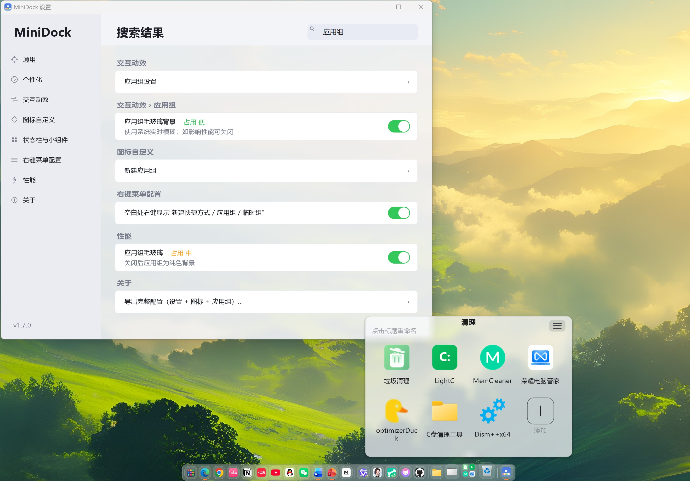

<!--
  维护者提示（发布前确认）：
  1. 顶部 logo 图片路径：docs/logo-128.png —— 如仓库内路径不同，请替换 raw.githubusercontent.com 链接；
  2. 语言切换链接指向 README.md / README.en.md —— 如文件名不同请一并修改；
  3. 下载链接：GitHub Releases 与夸克网盘，可按需替换；
  4. 官网地址：https://wang01116.github.io/MiniDock
-->

<div align="center">


# MiniDock

**一个约 400 KB 的 Windows Dock 与 macOS 式顶部状态栏**

纯 C + Win32 + GDI+ 手写，无 Electron、无 .NET、无 VC++ 运行库，单文件免安装。

[](#-系统特性)
[](#-极致低占用)
[](#-技术栈)
[](#-许可证)

[简体中文](README.md) · [English](README.en.md) · [官网](https://wang01116.github.io/MiniDock) · [下载](#-下载与安装)

<!-- 语言切换链接：如需指向其它文件名，请替换上面的 README.md / README.en.md -->



</div>

---

## 📖 目录

- [简介](#-简介)
- [功能说明](#-功能说明)
  - [Dock](#dock)
  - [起动台](#-起动台)
  - [顶部状态栏与小组件](#-顶部状态栏与小组件)
  - [系统集成](#-系统集成)
  - [设置中心](#-设置中心)
- [系统特性](#-系统特性)
- [视觉与动画](#-视觉与动画)
- [极致低占用](#-极致低占用)
- [与同类软件相比](#-与同类软件相比)
- [下载与安装](#-下载与安装)
- [使用方法](#-使用方法)
- [快速上手](#-快速上手)
- [从源码构建](#-从源码构建)
- [配置说明](#-配置说明)
- [目录结构](#-目录结构)
- [技术栈](#-技术栈)
- [常见问题](#-常见问题)
- [许可证](#-许可证)
- [致谢](#-致谢)

---

## 🌟 简介

MiniDock 是一个把 **Dock** 和 **macOS 式顶部状态栏**做轻、做透的 Windows 桌面工具。

它不追求"全家桶"，而是只做两件事：把常用应用与窗口收进底部 Dock，把时间、控制中心、托盘、电量等信息收进顶部状态栏 —— 然后用原生 Win32 把它们做到 **约 400 KB、无常驻动画定时器、空闲工作集个位数 MB**。

- 🪶 **轻**：单文件、双击即用、不写注册表、不驻留服务
- 🎛 **可控**：20 余项高耗能特效可单独关闭，提供低 / 适中 / 高资源三档预设
- 🧩 **原生**：纯 Win32 + GDI+ 手绘，Per-Monitor V2 DPI，无第三方 UI 框架
- 🆓 **免费开源**：源码公开，可自行编译、修改、分发

> 官网：<https://wang01116.github.io/MiniDock>

---

## 🧱 功能说明

### Dock

- **固定应用 / 文件夹 / 网址 / 开始菜单应用**，支持从开始菜单或资源管理器直接拖入
- **合并 / 独立窗口显示**：按应用合并，或像 macOS 一样每个文档、每个资源管理器窗口单独占一个图标
- **窗口预览**：悬停显示 DWM 实时缩略图，多窗口自动排列，点击直达
- **应用组**：把图标拖到一起成组，宫格卡片、可命名、可换图标、可调背景色与不透明度、可排序
- **文件夹弧形展开**：弧度可调（0 = 垂直），支持拖出文件、右键菜单与排序
- **速记**：富文本速记、临时保存、导出 txt / Markdown
- **临时周转组**：存放本次工作的文件，重启后自动清空
- **运行指示**：横条或圆点，颜色、样式、大小可调
- **任务栏控制**：隐藏 / 自动隐藏 / 永久隐藏，Ctrl 悬停可临时唤出；关闭后恢复系统原始设置
- **多显示器**：指定屏幕显示、跟随鼠标所在屏幕，或在**所有显示器同时显示**（逐屏镜像，按各屏 DPI 计算位置）

### 🚀 起动台

- 全屏网格或**小启动台**（居中紧凑窗口），共用应用列表、标签与背景设置
- 打字即搜、回车启动、Esc 关闭，支持中文输入法候选落在搜索框内
- **内置搜索引擎条**：Bing、百度、Google、Yandex、DuckDuckGo、Yahoo、搜狗、360、Ecosia、Bilibili、GitHub、知网、YouTube
  - 可启用 / 停用、**排序、改颜色、重命名、删除**
  - 支持**自定义引擎**（名称 + 带 `%s` 的网址模板 + 颜色）
  - 每个引擎可**单独绑定** Edge / Chrome / Firefox / 默认浏览器
- 标签分类、标签拖动排序、重命名与删除；标签上方即搜索框，布局自适应

### 📊 顶部状态栏与小组件

macOS 式顶部状态栏，也可只作为 Dock 小组件使用：

- 时间与日期（农历、干支、秒数、字体与颜色可调）
- 控制中心（WiFi、蓝牙、深色模式、定位、静音、音量、电量）
- 通知（接管任务栏闪烁 / 未读提醒，点击直达窗口）
- 资源监视器（CPU / 内存 / 磁盘）
- 计时器 / 待办、专注模式切换、系统托盘、电源菜单
- **电池健康**：设计容量、当前满充容量、健康度、循环次数（WMI 读取，缺失字段明确显示"暂不可用"）
- **输入法小组件**：显示"中 / EN"，点击切换；独立开关，不依赖顶部状态栏
- 小组件支持**双倍宽度**、合并胶囊、左右侧停靠与顺序调整

### 🧷 系统集成

- **微信 / QQ 托盘唤醒**：收进托盘后点击 Dock 图标，直接唤出可操作的聊天窗
- **未登录也能启动**：只有后台进程、没有窗口时点击图标，会启动登录窗口
- **应用家族严格匹配**：微信只点亮微信、QQ 只点亮 QQ，运行指示不串台
- **任务栏回避**：最大化窗口自动避让 Dock（可选）
- **开机自启**、全局快捷键、锁定布局防误拖
- **配置导入 / 导出**：整套设置、Dock 图标与起动台数据可备份迁移
- **诊断日志**：默认关闭，按需开启，仅记录运行事件与错误码，不含窗口标题、路径、输入与截图

### ⚙ 设置中心

自绘、云母（Mica）材质、随系统深浅色切换，支持搜索与逐页重置：

- 通用 / 个性化 / 位置与显示 / 交互动效 / 状态栏与小组件 / 图标自定义 / 右键菜单配置 / 性能 / 关于
- 每页底部支持**导出 / 导入本页设置**与**恢复本页默认值**
- 起动台、搜索引擎、电池等均有独立子页

---

## 🪟 系统特性

| 特性 | 说明 |
| --- | --- |
| 原生 Win32 | 纯 Win32 API + GDI+ 手绘，无 Electron / .NET / Qt / 浏览器内核 |
| 单文件免安装 | 主程序约 400 KB，释放到任意目录即可运行 |
| Per-Monitor V2 DPI | 跨不同缩放比例的显示器保持窗口、图标、字体一致 |
| AppBar 集成 | 通过 Shell AppBar 预留桌面空间，最大化窗口自动避让 |
| WinEvent 钩子 | 最小化 / 还原动画基于快照，不阻塞窗口线程 |
| WMI 电池数据 | 读取固件上报的设计容量、满充容量与循环次数 |
| UI Automation | 通过任务栏托盘按钮唤醒托盘应用，不移动真实光标 |
| 单实例 + 热键 | 重复启动会唤出已有实例；全局快捷键可自定义 |
| 配置与日志 | ini 配置可迁移；诊断日志可选、可导出、有体积上限 |

---

## 🎨 视觉与动画

- **快照神奇效果**：最小化 / 还原使用同一张快照做条带折叠，Electron 与资源管理器有兜底抓取；标题栏最小化不闪帧，恢复比例与落点一致
- **磨砂 / 冻结背景**：Dock 与起动台支持实时模糊、冻结桌面、纯色 / 渐变底盘
- **图标倒影、悬停放大、按压反馈、提示标签**：全部可单独开关
- **状态栏动效**：悬停 / 按压过渡、胶囊展开、控制中心弹出
- **云母设置窗口**：固定 Mica 材质，随系统主题变化
- **动画不抢资源**：帧间隔按显示器刷新率对齐 `DwmFlush`，没有常驻动画定时器

---

## 🍃 极致低占用

- **体积**：常规构建约 400 KB，UPX 压缩后约 190 KB
- **工作集**：启动完成即归还一次，之后每 10 秒（无动画时）自动归还；空闲时可降到个位数 MB
- **私有内存**：约 14–16 MB
- **无常驻动画定时器**：静止时不产生周期性重绘
- **按需启动**：状态栏、守护进程、镜像窗口、引擎条等只在启用时创建
- **节能模式**：一键关闭磨砂、预览、倒影、动画等全部高耗能特效；支持低电量自动节能
- **性能预设**：低资源 / 适中 / 高资源三档，20 余项开关可细调

---

## 🥊 与同类软件相比

> 对比基于公开资料与常见使用反馈；同类软件能力请以其官网与最新版本为准。

| 对比项 | **MiniDock** | MyDockFinder | BitDock |
| --- | --- | --- | --- |
| 定位 | Dock + 顶部状态栏，轻量专注 | Dock + 状态栏 + 系统美化套件 | 桌面美化与图标整理 |
| 体积 | **约 400 KB，单文件** | 安装包 / Steam，体积更大 | 安装包，体积更大 |
| 运行依赖 | **无（纯 Win32）** | 需要额外运行时与组件 | 需要额外运行时 / 组件 |
| 内存 | **空闲工作集个位数 MB** | 高于 MiniDock | 高于 MiniDock |
| 价格 / 源码 | **免费、开源** | 付费，闭源 | 免费版 + 付费版，闭源 |
| 窗口预览 | ✅ DWM 实时缩略图 | ✅ 含 UWP | ✅ |
| 神奇效果动画 | ✅ 快照条带折叠，最小化 / 还原对称 | ✅ D3D11 多种效果 | 提供多种动画样式 |
| 应用组 / 文件夹扇形 | ✅ 宫格组 + 弧形展开 | ✅ 基础支持 | 支持分组与托盘 |
| 起动台搜索引擎条 | ✅ 13 个内置 + 自定义 + 逐引擎浏览器 | — | — |
| 多显示器 | ✅ 指定屏 / 跟随鼠标 / 逐屏镜像 | ✅ | ✅ |
| 顶部状态栏 | ✅ 时间、控制中心、托盘、电量、资源、专注模式 | ✅ MyFinder | 以 Dock 与桌面美化为主 |
| 电池健康（WMI） | ✅ 容量 / 健康度 / 循环次数 | — | — |
| 输入法小组件 | ✅ 独立开关，Dock 也能显示 | 状态栏内 | — |
| 天气（联网） | ❌ 不做 | ✅ | — |
| 媒体控制 / 每程序音量 | ❌ 不做 | ✅ | 提供媒体控制 |

**MiniDock 的竞争优势**

1. **极致轻量**：单文件约 400 KB，无运行时依赖，绿色免安装；
2. **极低占用**：空闲工作集可降到个位数 MB，没有常驻动画定时器；
3. **完全免费开源**：C + Win32 源码公开，可自行编译与二次开发；
4. **Dock 与状态栏一体**：一个进程同时提供两类 macOS 体验，而不是各装一套；
5. **细节控制力**：20 余项高耗能开关、每页重置、配置导入导出；
6. **面向真实使用**：托盘微信 / QQ 唤醒、未登录可启动、多显示器镜像、电池健康等场景化能力。

如果你需要天气、媒体控制、完整的系统级美化，MyDockFinder 更合适；如果你主要想装饰桌面与整理图标，BitDock 更合适。

---

## 📥 下载与安装

**推荐渠道**

- 🐙 **GitHub Releases**：<https://github.com/wang01116/MiniDock/releases/latest>
- ☁️ **夸克网盘（国内）**：<https://pan.quark.cn/s/d1ef9e835fbd#/list/share>

**安装**

1. 下载 `MiniDock.exe`（或压缩版）；
2. 放到任意目录（建议非系统盘，例如 `D:\Apps\MiniDock`）；
3. 双击运行即可，无需安装、无需管理员权限；
4. 首次运行会在同目录或 `%APPDATA%\MiniDock` 生成配置。

> Windows 10 / 11 x64。部分美化能力（Mica 等）需要 Windows 11 22H2 及以上。

---

## 🕹 使用方法

| 操作 | 说明 |
| --- | --- |
| 左键点击 Dock 图标 | 启动 / 切换窗口；再次点击可最小化 |
| 右键 Dock 图标 | 打开、定位、复制路径、加入托盘常驻、从 Dock 移除等 |
| 拖动图标 | 调整顺序；拖到另一个图标上停留即可合成应用组 |
| 悬停图标 | 放大、显示名称、显示窗口预览 |
| 右键 Dock 空白处 | 打开设置、锁定布局、退出 |
| 全局快捷键 | 默认显示 / 隐藏 Dock，可在设置中修改 |
| 顶部状态栏 | 点击时间弹日历，点击控制中心 / 托盘 / 电量弹对应面板 |
| 起动台 | 打开后直接输入搜索；点引擎胶囊切换搜索引擎，回车用所选引擎搜索 |
| 小启动台 | 紧凑窗口，点击外部自动关闭；右键应用可固定 / 移除 |

---

## ⚡ 快速上手

1. **启动**：双击 `MiniDock.exe`，Dock 出现在屏幕底部；
2. **添加应用**：把桌面快捷方式、文件夹或网址拖到 Dock；
3. **整理**：拖动排序，把同类应用拖到一起合成应用组；
4. **状态栏**：设置 → 状态栏与小组件，开启「macOS 式顶部状态栏」，按需勾选小组件；
5. **调优**：设置 → 性能，选择「低资源 / 适中 / 高资源」，或逐项关闭不用的特效。

---

## 🔧 从源码构建

**环境**

- Windows 10 / 11 x64
- MinGW-w64（x86_64，含 `gcc` 与 `windres`）

**编译**

```bat
windres -O coff res/app.rc -o build_res.o -Ires
gcc -Oz -fno-ident -fno-unwind-tables -fno-asynchronous-unwind-tables ^
    -fmerge-all-constants -fno-math-errno -mno-stack-arg-probe -fno-jump-tables ^
    -mwindows -s -static-libgcc ^
    -Wl,--gc-sections,--file-alignment=512 ^
    -o MiniDock.exe minidock.c modules\battery_health\battery_health.c build_res.o ^
    -lgdiplus -lole32 -loleaut32 -lshell32 -lshlwapi -luser32 -lgdi32 ^
    -lcomctl32 -lcomdlg32 -luuid -lwbemuuid -lurlmon -lversion -ldwmapi ^
    -ladvapi32 -lpsapi -luxtheme -liphlpapi -limm32 -lwtsapi32 -lpowrprof ^
    -lmsimg32 -lwinmm -luiautomationcore
```

> 包内 `build.bat` 已包含等价参数；若使用 `-ffunction-sections -fdata-sections`，在 512 文件对齐下体积会显著变大，不建议。

---

## ⚙ 配置说明

- 配置文件：`MiniDock.ini`（优先读取 exe 同目录；若存在 `%APPDATA%\MiniDock\location.txt` 则按其中路径重定向）
- 主要分组：Dock 外观与行为、位置与显示器、动画、状态栏与小组件、起动台、搜索引擎、电池、性能与开关
- 设置页支持**整页导出 / 导入**，关于页支持**完整配置导出**与**恢复默认**
- 诊断日志：默认关闭，开启后写入配置目录，约 2 MiB 上限，可导出 / 清空

**搜索引擎配置示例**

```ini
[SearchEngines]
Count=2
Name0=Bing
Url0=https://www.bing.com/search?q=%s
Color0=0x66B4F0F7
On0=1
Browser0=0
Name1=我的引擎
Url1=https://example.com/search?q=%s
Color1=0xFF3A6EA5
On1=1
Browser1=2
```

> `%s` 为搜索词占位符；`Browser` 0 = 默认浏览器，1 = Edge，2 = Chrome，3 = Firefox。

---

## 📁 目录结构

```text
MiniDock/
├─ minidock.c                 # 主程序（单文件）
├─ modules/
│  └─ battery_health/         # WMI 电池健康模块（.c / .h）
├─ res/
│  ├─ app.rc                  # 资源脚本（图标 / 版本信息 / manifest）
│  ├─ app.manifest            # DPI 感知与兼容性声明
│  └─ app.ico                 # 应用图标
├─ build.bat                  # 构建脚本
├─ README.md                  # 中文说明（本文件）
└─ README.en.md               # English README
```

---

## 🧰 技术栈

- **语言**：C（C99 风格，MinGW-w64 GCC）
- **界面**：Win32 API + GDI+ 手绘，双缓冲与分层窗口
- **系统能力**：AppBar、WinEvent Hook、DWM（Mica / 缩略图）、WMI、UI Automation、Shell API
- **构建**：windres + gcc，静态链接，无外部运行时
- **产物**：单个 `MiniDock.exe` + 可选 UPX 压缩版

---

## ❓ 常见问题

<details>
<summary>需要安装 .NET / VC++ 运行库吗？</summary>

不需要。程序静态链接，只用系统自带的 Win32 与 GDI+。

</details>

<details>
<summary>会写注册表或常驻服务吗？</summary>

不会。仅在你开启"开机自启"时写入当前用户启动项；不注册服务、不安装驱动。

</details>

<details>
<summary>为什么空闲内存显示会波动？</summary>

工作集包含与系统共享的页面，MiniDock 会周期性归还工作集，任务管理器里看到的数值会随系统状态浮动；私有内存在 14–16 MB 左右。

</details>

<details>
<summary>支持 Windows 10 吗？</summary>

支持。Mica 等部分材质需要 Windows 11 22H2 及以上，低版本会自动回退为纯色 / 磨砂。

</details>

<details>
<summary>和 MyDockFinder / BitDock 怎么选？</summary>

见上方[对比表](#-与同类软件相比)：要极致轻量与可控选 MiniDock，要一站式全家桶选 MyDockFinder，要桌面美化与图标整理选 BitDock。

</details>

---

## 📄 许可证

本仓库当前未附带 `LICENSE` 文件；在添加许可证前，代码版权归作者所有。若你希望以 MIT 等方式开源分发，请在仓库根目录添加 `LICENSE` 文件，并在此处更新说明。

---

## 🙏 致谢

- 感谢所有提交 Issue、反馈 Bug 与提出建议的用户；
- 感谢 GDI+、Win32、DWM、WMI 等系统能力让"小体积、原生体验"成为可能；
- 感谢开源社区提供的工具链与参考资料。

<div align="center">

**[⬆ 回到顶部](#minidock)** · [官网](https://wang01116.github.io/MiniDock) · [Releases](https://github.com/wang01116/MiniDock/releases) · [Issues](https://github.com/wang01116/MiniDock/issues)

</div>
